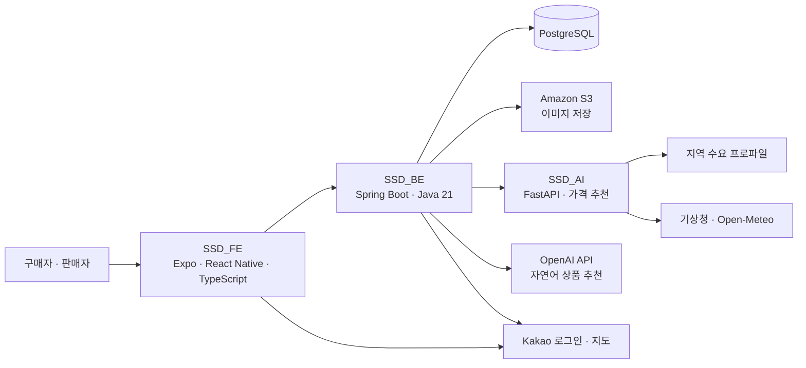

<p align="center">
  
</p>

<h1 align="center">제주 로컬타임 AI</h1>

<p align="center">
  <strong>제주의 남은 재고와 시간을, 새로운 거래 기회로.</strong><br />
  공공데이터 기반 지역 수요와 날씨·재고·마감 시간을 결합하는 마감 상품 거래 서비스
</p>

<p align="center">
  <a href="#데모-영상">▶ 데모 영상</a> ·
  <a href="#주요-기능">주요 기능</a> ·
  <a href="#검증-결과">검증 결과</a> ·
  <a href="#시스템-구조">시스템 구조</a> ·
  <a href="제주로컬타임AI_통합본선_발표자료.pdf">발표자료 PDF</a> ·
  <a href="docs/README.md">상세 문서</a> ·
  <a href="https://github.com/MecchaChameleon">Team SSD</a>
</p>

## 프로젝트 소개

제주 로컬타임 AI는 지역 소상공인의 마감 상품과 구매자를 연결하는 서비스입니다. 판매자는 남은 상품과 판매 가능 시간을 등록하고, 지역 수요·날씨·재고 상황을 반영한 추천 가격을 참고해 판매할 수 있습니다. 구매자는 주변 상품을 지도와 목록으로 탐색하고, 자연어로 원하는 조건을 입력해 상품을 추천받을 수 있습니다.

판매 기록이 부족한 초기에도 공공데이터에서 지역 수요의 단서를 얻고, 판매자가 정한 가격 범위 안에서 판매 의사결정을 돕는 것을 목표로 합니다.

**[통합본선 발표자료 PDF](제주로컬타임AI_통합본선_발표자료.pdf)** · [부록 18~25쪽 모아보기](docs/presentation-appendix.md)

| 사용자 | 해결하려는 문제 | 제공하는 경험 |
|---|---|---|
| 판매자 | 마감 전 남은 상품을 얼마에 판매할지 판단하기 어려움 | 상품 등록, 가격 추천과 근거 확인, 판매·재고 관리 |
| 구매자 | 주변 마감 상품과 이용 가능한 시간을 파악하기 어려움 | 위치 기반 탐색, 조건에 맞는 상품 추천, 구매 내역 확인 |

## 데모 영상

<p align="center">
  <a href="assets/videos/demo.mp4">
    
  </a>
</p>

약 **1분 4초**의 전체 시연을 GIF로 반복 재생합니다. **[▶ 원본 MP4 영상 보기](assets/videos/demo.mp4)**에서 음성이 포함된 영상을 열거나 내려받을 수 있습니다.

## 주요 기능

### 구매자

- **주변 상품 탐색**: 위치를 기준으로 마감 상품을 지도와 목록에서 확인합니다.
- **AI 상품 추천**: 자연어로 입력한 조건을 바탕으로 상품을 추천받습니다.
- **관심 상품 관리**: 관심 있는 상품을 찜 목록에 저장합니다.
- **구매 내역 확인**: 구매 요청과 판매자 처리 상태를 확인합니다.

### 판매자

- **판매자 등록과 상품 관리**: 사업자 정보와 판매할 상품, 수량, 판매 시간을 등록합니다.
- **가격 추천**: 정상가와 최저가 범위 안에서 추천 가격과 산출 근거를 확인합니다.
- **목적별 가격안**: 수익 우선·균형·재고 처리 우선의 가격안을 비교합니다.
- **주기적 가격 재계산**: 활성 상품의 재고와 경과 시간 등을 반영해 기본 10분 주기로 가격을 재계산합니다.
- **판매 현황 관리**: 구매 요청 처리, 매출 보고서와 정산 요청을 관리합니다.

> 구매·정산 상태 관리 기능과 외부 결제사의 실제 승인·송금 연동은 구분합니다. 현재 구매 API는 주문 및 결제 상태를 내부에서 기록하는 방식입니다.

## AI 가격 추천은 어떻게 동작하나요?

```text
공공데이터 기반 지역 수요 + 날씨 + 재고 + 판매 경과 시간 + 최근 판매속도
                                    ↓
                       설명 가능한 가격 결정 정책
                                    ↓
                  판매자 최저가 ~ 정상가 범위로 가격 제한
                                    ↓
                 목적별 가격안 · 추천 근거 · 판매자 선택
```

**지역 수요 모델과 최종 가격 정책은 서로 다른 역할을 합니다.** 현재 가격 서버는 일별 EBM 수요 프로파일을 읽고, 가격 정책은 재고·시간·날씨 등의 요인을 결합해 추천가를 계산합니다. 가격 정책의 가중치는 합성 구매자 시뮬레이션에서 보정했습니다.

별도로 XGBoost 수요예측 비교 실험도 진행했습니다. 해당 실험의 성능 수치를 현재 가격 서버의 운영 모델 성능과 혼용하지 않습니다.

자세한 설명과 평가 조건은 [AI 가격 추천 및 검증 문서](docs/ai-pricing.md)에 정리했습니다.

<details>
<summary>가격 결정 요인과 실제 추천 화면 — 발표자료 20쪽</summary>

지역 수요, 잔여 재고, 판매속도, 경과율, 날씨를 할인 압력에 반영합니다. 판매자는 수익 우선·균형·판매 우선의 가격안과 각 추천의 근거를 함께 확인할 수 있습니다.

[](제주로컬타임AI_통합본선_발표자료.pdf#page=20)

</details>

## 검증 결과

아래 수치와 이미지는 **통합본선 발표자료**를 기준으로 정리했습니다. 수요예측은 모델 평가, 가격정책은 합성 사용자 실험으로 각각 검증했습니다.

### 1. 공공데이터 기반 수요예측

제주 **43개 읍면동**, **22,188건**의 유동인구·입도객수 데이터를 사용한 XGBoost 검증 결과입니다. 자료의 데이터 범위는 **2025년 1월~2026년 5월**이며, 19쪽에 표시된 테스트 데이터는 전체의 20%인 **4,438건**입니다.

| 지표 | 발표자료 결과 | 근거 페이지 |
|---|---:|---|
| WAPE | **3.07%** | [19쪽](assets/images/appendix/page-19.png) |
| R² | **0.995** | [19쪽](assets/images/appendix/page-19.png) |
| MAE | **1,208명** | [PDF 6쪽](제주로컬타임AI_통합본선_발표자료.pdf#page=6) |

[](제주로컬타임AI_통합본선_발표자료.pdf#page=19)

43개 읍면동 중 우도면·추자면은 작은 방문인구 규모에 따른 오차 민감도로 인해 **지역 간 비교 그래프에서 제외**되어, 그래프는 41개 지역을 표시합니다. 위 결과는 수요예측 성능이며 실제 구매·매출 개선율을 뜻하지 않습니다. 기존 시간순 홀드아웃 실험과는 데이터 범위와 평가 조건이 달라 직접 비교하지 않습니다.

### 2. 페르소나 기반 가격정책 검증

**5개 구매자 페르소나**, **180일·1,800개 상품**, **전략별 합성 사용자 54,623명**을 대상으로 가격정책을 비교했습니다. 시간순 앞 60%에서 가중치를 보정하고, 사용하지 않은 뒤 40%를 홀드아웃 평가에 사용했습니다.

| 평가 항목 | 보정 후 균형형 규칙정책의 결과 |
|---|---:|
| LinUCB 대비 매출 | **99.5% 수준** |
| LinUCB 대비 폐기 반영 순이익 | **99.2% 수준** |
| 기존 규칙 대비 매출 변화 | **+1.81%** |
| 기존 규칙 대비 폐기 반영 순이익 변화 | **+2.97%** |
| 기존 규칙 대비 재고 소진율 변화 | **+7.68%p** |

[](제주로컬타임AI_통합본선_발표자료.pdf#page=21)

가격정책은 합성 구매행동으로 보정한 규칙 기반 정책입니다. 위 수치는 정책 간 상대 비교이며 실제 고객의 구매 효과를 입증하는 수치는 아닙니다. 실제 거래 데이터가 쌓이면 구매확률·가격탄력성을 보정하고 학습형 정책을 검증할 계획입니다.

### 3. 자연어 조건 검색과 추천 근거

“애월 근처 2명, 오늘 저녁, 4만원 이하”처럼 입력하면 위치·인원·시간·예산 조건을 해석하고, **점포 DB에 등록된 판매 상품의 가격·재고·할인 정보**를 바탕으로 추천 후보를 구성합니다. 결과에는 상품 정보와 추천 이유를 함께 제공합니다.

[](제주로컬타임AI_통합본선_발표자료.pdf#page=22)

발표자료의 JSON은 주요 입출력을 요약한 예시입니다. 실제 추천 API의 전체 응답 스키마는 백엔드 구현을 기준으로 확인합니다.

## 인프라 운영 규모와 비용 추정

부하테스트에서 측정한 호출당 사용량을 거래량 시나리오로 환산한 **발표자료의 추정치**입니다. 거래 1건당 백엔드 요청 100건을 가정하고, 서버·DB는 단계별 플랜, 저장소·언어모델 API는 사용량으로 계산했습니다.

| 월 기준 시나리오 | 1년차 | 2년차 | 3년차 |
|---|---:|---:|---:|
| 거래량 가정 | 900건 | 3,600건 | 10,800건 |
| 백엔드 요청량 | 90,000건 | 360,000건 | 1,080,000건 |
| 피크 요청률 추정 | 0.51 RPS | 2.05 RPS | 6.16 RPS |
| 인프라·언어모델 API 비용 추정 | **$22.28** | **$39.14** | **$67.41** |
| 인프라 비용 회수 거래량 | 41건/월 | 71건/월 | 122건/월 |

출처: [인프라 비용 상세 — 24쪽](assets/images/appendix/page-24.png), [인프라비 기준 손익 참고치 — 23쪽](assets/images/appendix/page-23.png). 비용 회수 거래량은 건당 수수료 약 750원 가정의 **인프라비 한정 참고치**이며, 인건비·마케팅비 등을 포함한 사업 전체 손익분기점은 아닙니다. 요금과 환율은 발표자료 산정 시점의 가정을 사용한 것으로 현재 청구액을 뜻하지 않습니다.

<details>
<summary>부하테스트 기반 3개년 사용량·비용 표 — 발표자료 24쪽</summary>

[](제주로컬타임AI_통합본선_발표자료.pdf#page=24)

</details>

AI 기능별 입력·출력, 재무 시나리오와 고객획득비 가정까지 포함한 원문은 [부록 페이지 모음](docs/presentation-appendix.md)에서 확인할 수 있습니다.

## 시스템 구조



자연어 상품 추천은 백엔드가 외부 언어모델 API와 연동하고, 판매자 가격 추천은 별도 AI 서비스가 담당합니다. 상세 요청 흐름은 [아키텍처 문서](docs/architecture.md)를 참고하세요.

## 기술 스택

| 영역 | 사용 기술 |
|---|---|
| 프론트엔드 | Expo 54, React Native, React, TypeScript |
| 백엔드 | Java 21, Spring Boot 3.3, Spring Security, JPA, JDBC |
| 데이터베이스 | PostgreSQL, Flyway |
| AI 서비스 | Python, FastAPI, NumPy, EBM 기반 수요 프로파일 |
| 모델·정책 실험 | EBM, XGBoost, 합성 페르소나 시뮬레이션, LinUCB 비교 |
| 외부 연동 | Kakao 로그인·지도·행정구역 조회, 기상청, Open-Meteo, OpenAI API |
| 배포·저장 | Vercel, Render, Docker, Amazon S3 |

## 저장소 구성

이 저장소는 서비스 전체를 소개하고 문서와 시연 자료를 모으는 공간입니다. 각 서비스의 소스 코드와 실행 방법은 아래 저장소에서 관리합니다.

| 저장소 | 역할 | 실행 안내 |
|---|---|---|
| **SSD** | 프로젝트 소개, 통합 문서, 데모 영상, 개인정보처리방침 | 현재 저장소 |
| [SSD_FE](https://github.com/MecchaChameleon/SSD_FE) | 구매자·판매자 앱과 웹 화면 | [프론트엔드 README](https://github.com/MecchaChameleon/SSD_FE#readme) |
| [SSD_BE](https://github.com/MecchaChameleon/SSD_BE) | 인증, 상품·거래·정산 API, AI 연동 | [백엔드 README](https://github.com/MecchaChameleon/SSD_BE#readme) |
| [SSD_AI](https://github.com/MecchaChameleon/SSD_AI) | 수요 데이터 처리, 가격 추천 API, 모델·정책 검증 | [AI README](https://github.com/MecchaChameleon/SSD_AI#readme) |

## 문서

| 문서 | 내용 |
|---|---|
| [문서 모음](docs/README.md) | 통합 문서와 기존 기술 보고서의 바로가기 |
| [통합본선 발표자료 PDF](제주로컬타임AI_통합본선_발표자료.pdf) | 서비스 소개와 AI·재무 부록을 포함한 전체 26쪽 |
| [발표자료 부록 모음](docs/presentation-appendix.md) | 18~25쪽 원문 이미지, 검증 조건과 수치 해석 |
| [시스템 아키텍처](docs/architecture.md) | 서비스 간 역할, 요청 흐름, 데이터와 외부 API |
| [AI 가격 추천 및 검증](docs/ai-pricing.md) | 수요예측, 가격 정책, 합성실험 결과와 해석 범위 |
| [개인정보처리방침](index.html) | 기존 privacy 저장소의 공개 문서 |

<details>
<summary>이 저장소의 파일 구성</summary>

```text
SSD/
├── README.md
├── index.html                 # 기존 개인정보처리방침
├── 제주로컬타임AI_통합본선_발표자료.pdf
├── assets/
│   ├── images/                # 서비스 로고·아이콘·부록 페이지 이미지
│   └── videos/                # 데모 GIF와 원본 MP4
└── docs/
    ├── README.md              # 문서 모음
    ├── architecture.md        # 시스템 구조
    ├── ai-pricing.md          # AI 구조와 검증
    ├── presentation-appendix.md # 발표자료 부록과 근거
    └── repository-setup.md    # privacy → SSD 전환 안내
```

</details>

---

**Team SSD** · [GitHub Organization](https://github.com/MecchaChameleon)
