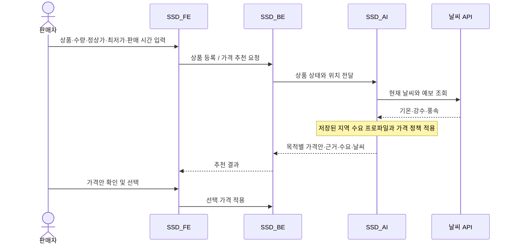

# 시스템 아키텍처

제주 로컬타임 AI는 사용자 화면, 비즈니스 API, 가격 추천 서비스를 별도 저장소로 관리합니다. 이 문서는 현재 코드에서 확인되는 역할과 호출 관계를 설명합니다.

## 서비스별 역할

| 구성 | 역할 | 주요 기술 |
|---|---|---|
| SSD_FE | 구매자·판매자 화면, 지도 탐색, 사용자 입력과 API 호출 | Expo, React Native, TypeScript |
| SSD_BE | 사용자 인증, 상품·재고·거래 상태, 판매 보고서, 정산 요청, AI 연동 | Spring Boot, PostgreSQL |
| SSD_AI | 지역 수요·날씨·상품 상태를 결합한 가격 추천 | FastAPI, 수요 프로파일, 가격 정책 |
| SSD | 서비스 소개, 통합 문서, 시연 자료, 개인정보처리방침 | Markdown, HTML, MP4 |

## 판매자 가격 추천

활성 상품은 백엔드 스케줄러가 기본 10분 주기로 가격을 재계산합니다. 이 주기는 `ai.pricing.interval-ms` 설정으로 조정합니다. 추천 가격은 판매자가 지정한 최저가와 정상가 범위로 제한됩니다.

백엔드와 AI 서비스는 `AI_SERVICE_BASE_URL`로 연결하며, 가격 API 호출에는 `X-AI-Service-Key` 헤더를 사용합니다. 브라우저와 앱에는 이 서비스 키를 전달하지 않습니다.

## 구매자 자연어 추천

1. 구매자가 원하는 상품이나 조건을 입력합니다.
2. 프론트엔드가 백엔드의 `/api/buyer/ai-recommendations`를 호출합니다.
3. 백엔드가 후보 상품과 요청 조건을 바탕으로 외부 언어모델 API를 호출합니다.
4. 추천 결과를 상품 정보와 함께 화면에 표시합니다.

이 기능은 판매자 가격 추천용 FastAPI 서비스와 별도 경로로 동작합니다.

## 데이터와 외부 연동

| 구성 | 용도 |
|---|---|
| PostgreSQL | 회원, 상품, 주문, 찜, 알림, 정산 요청 등 서비스 데이터 |
| Flyway | 데이터베이스 스키마 변경 이력 관리 |
| Amazon S3 | 상품·프로필 이미지 저장 |
| Kakao | 소셜 로그인, 지도, 좌표 기반 행정구역 확인 |
| 제주데이터허브 | 지역 수요 모델 학습용 유동인구 데이터 |
| 기상청 | 제주 지역 초단기 실황·예보 |
| Open-Meteo | 기상청 조회 실패 시 대체 날씨 정보 |
| OpenAI API | 구매자 자연어 상품 추천 |

지역 수요 프로파일은 오프라인 학습 결과를 파일로 저장해 사용합니다. 매 가격 추천 요청마다 유동인구 학습 API를 다시 호출하는 구조는 아닙니다. 날씨 조회에는 캐시와 대체 경로가 있습니다.

## 배포 구성과 실행 안내

프론트엔드에는 Vercel 배포 설정이, 백엔드와 AI 서비스에는 Render 배포 설정이 있습니다. 백엔드는 Docker 빌드를 사용합니다. 실제 배포 주소와 자원 사양은 환경 설정에 따라 달라집니다.

- [프론트엔드 실행 방법](https://github.com/MecchaChameleon/SSD_FE#readme)
- [백엔드 실행 방법](https://github.com/MecchaChameleon/SSD_BE#readme)
- [AI 서비스 실행 방법](https://github.com/MecchaChameleon/SSD_AI#readme)

## 구현 범위

현재 구매 API는 내부 주문 생성 시 결제 상태를 기록하고, 판매자 수락·거절과 정산 요청 상태를 관리합니다. 외부 PG의 결제 승인·취소와 실제 은행 송금까지 연동되었다는 의미는 아닙니다.

## 구현 근거

- [백엔드 API 컨트롤러](https://github.com/MecchaChameleon/SSD_BE/blob/main/src/main/java/com/jejulocaltime/api/controller/FrontendApiController.java)
- [구매·판매·정산 처리](https://github.com/MecchaChameleon/SSD_BE/blob/main/src/main/java/com/jejulocaltime/api/service/FrontendApiService.java)
- [구매자 자연어 추천](https://github.com/MecchaChameleon/SSD_BE/blob/main/src/main/java/com/jejulocaltime/api/service/BuyerAiRecommendationService.java)
- [가격 재계산 스케줄러](https://github.com/MecchaChameleon/SSD_BE/blob/main/src/main/java/com/jejulocaltime/api/service/AiAutoPricingScheduler.java)
- [가격 추천 API](https://github.com/MecchaChameleon/SSD_AI/blob/main/app/main.py)
- [지역 수요 프로파일 조회](https://github.com/MecchaChameleon/SSD_AI/blob/main/app/demand.py)
- [날씨 조회 및 대체 처리](https://github.com/MecchaChameleon/SSD_AI/blob/main/app/weather.py)
