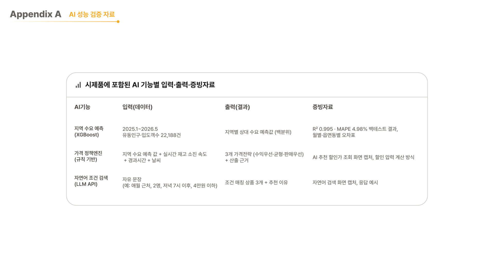
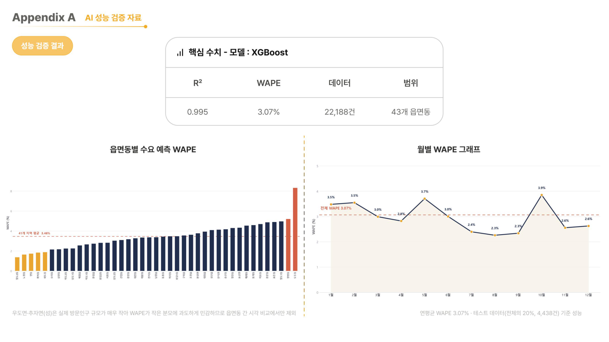
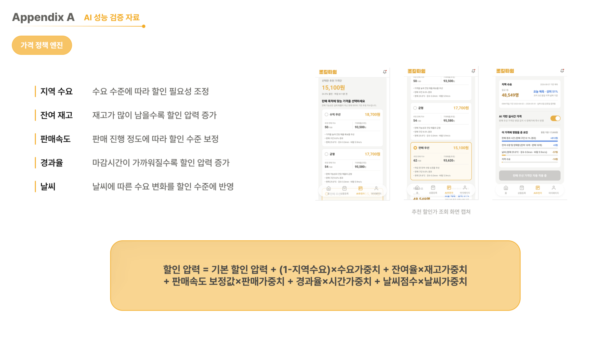
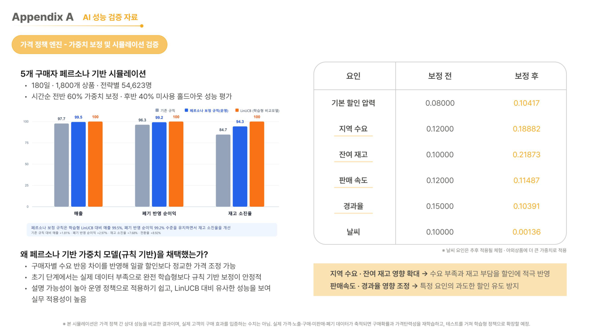
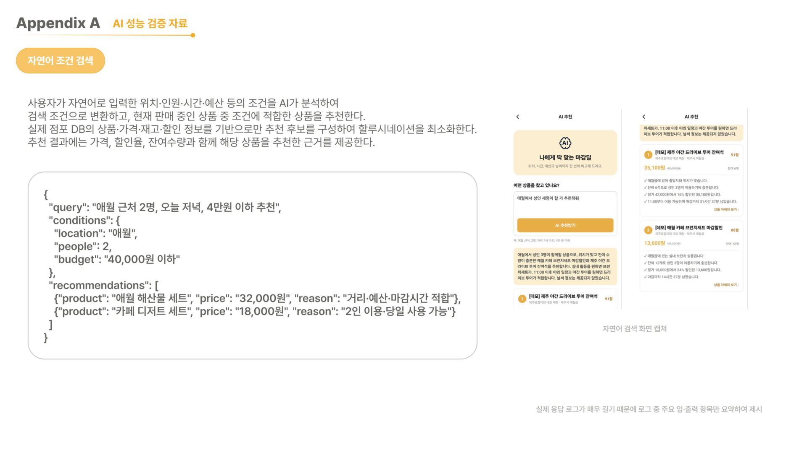
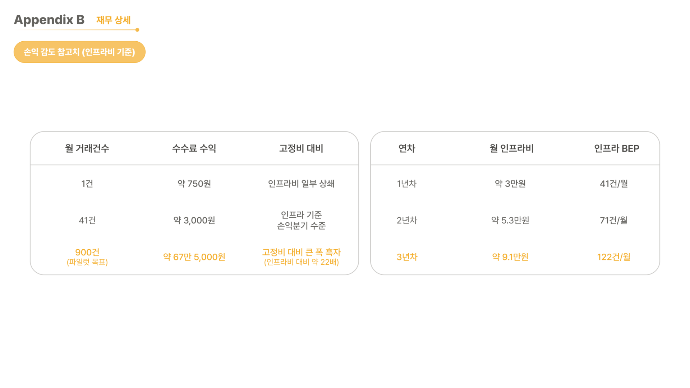
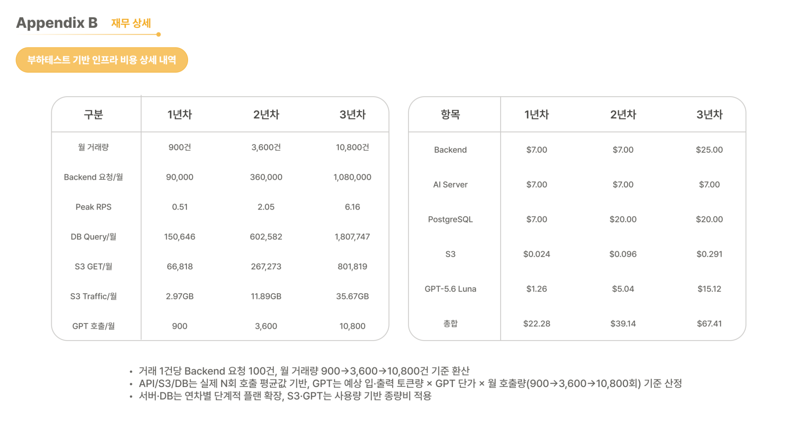
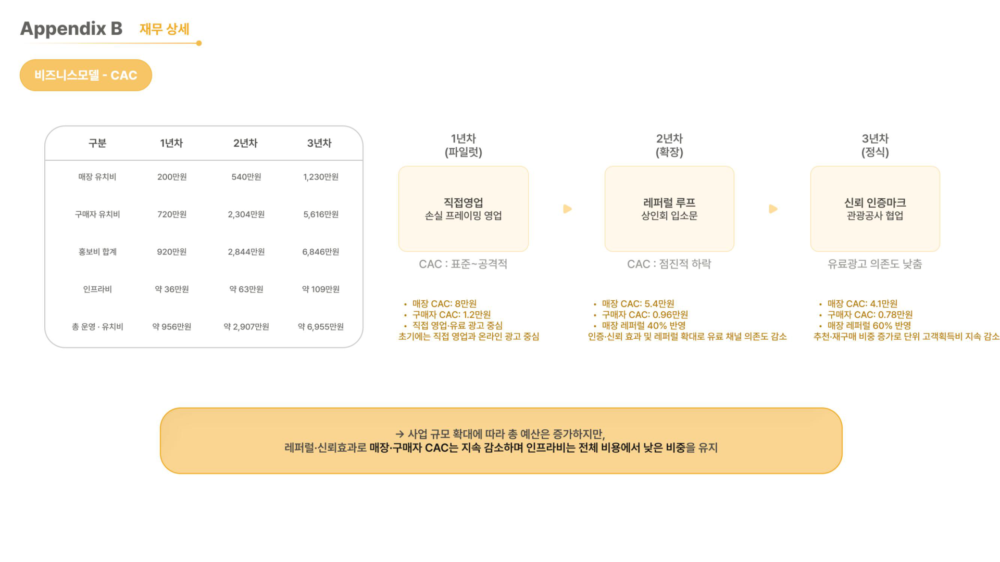

# 통합본선 발표자료 부록

[전체 PDF 열기](../제주로컬타임AI_통합본선_발표자료.pdf) · [대표 README로 돌아가기](../README.md)

전체 26쪽 중 부록 18~25쪽을 원문 이미지로 모았습니다. 페이지 번호는 PDF의 첫 페이지를 1쪽으로 센 순서입니다. 이미지는 내용을 수정하지 않고 PDF에서 추출했습니다. PDF 링크의 `#page=N` 이동은 사용하는 뷰어에 따라 다를 수 있으며, 아래 이미지는 해당 페이지를 바로 보여줍니다.

## 페이지 안내

| 페이지 | 주제 | 확인할 내용 |
|---|---|---|
| [18쪽](#18쪽--ai-기능별-입력출력증빙) | AI 기능 구성 | 수요예측·가격정책·자연어 검색의 입력, 출력, 증빙 |
| [19쪽](#19쪽--수요예측-성능) | 수요예측 성능 | XGBoost 성능과 읍면동별·월별 WAPE |
| [20쪽](#20쪽--가격-정책-엔진) | 가격 정책 | 할인 압력 계산 요인과 실제 추천 화면 |
| [21쪽](#21쪽--가격정책-가중치-보정과-합성실험) | 정책 검증 | 합성 페르소나, 홀드아웃, 가중치 보정, LinUCB 비교 |
| [22쪽](#22쪽--자연어-조건-검색) | 자연어 추천 | 상품 DB 기반 후보와 조건 검색의 입출력 예시 |
| [23쪽](#23쪽--인프라비-기준-손익-참고치) | 인프라 비용 회수 | 연차별 월 비용과 필요 거래량 |
| [24쪽](#24쪽--부하테스트-기반-인프라-비용) | 사용량·비용 추정 | 월 거래량 900·3,600·10,800건의 비용 시나리오 |
| [25쪽](#25쪽--고객획득비와-확장-가정) | 고객획득비(CAC) | 매장·구매자 유치비와 단계별 확장 가정 |

## 18쪽 — AI 기능별 입력·출력·증빙

수요예측은 지역별 상대 수요, 규칙 기반 가격정책은 목적별 가격안과 산출 근거, 자연어 검색은 조건에 맞는 상품과 추천 이유를 제공합니다.

## 19쪽 — 수요예측 성능

XGBoost의 발표자료 표기는 **R² 0.995, WAPE 3.07%, 데이터 22,188건, 43개 읍면동**입니다. 데이터 기간은 18쪽의 2025년 1월~2026년 5월이며, 테스트 표본은 전체의 20%인 4,438건입니다. 6쪽의 요약에는 MAE 1,208명도 제시됩니다.

지역별 그래프는 우도면·추자면을 제외한 41개 지역이고, 지역 평균 WAPE는 3.46%입니다. 전체 WAPE와 지역별 오차의 단순 평균은 서로 다른 집계입니다.

## 20쪽 — 가격 정책 엔진

지역 수요·잔여 재고·판매속도·경과율·날씨를 결합해 할인 압력을 계산합니다. 추천 가격과 함께 각 요인의 기여를 확인하고 판매 목적에 맞는 안을 선택하는 화면입니다.

## 21쪽 — 가격정책 가중치 보정과 합성실험

5개 합성 페르소나·180일·1,800개 상품·전략별 54,623명의 시나리오에서 시간순 앞 60%를 보정에, 뒤 40%를 평가에 사용했습니다.

균형형 규칙정책은 보정 후 LinUCB 대비 매출 99.5%, 폐기 반영 순이익 99.2% 수준이었습니다. 기존 규칙 대비 매출 +1.81%, 폐기 반영 순이익 +2.97%, 재고 소진율 +7.68%p는 동일 홀드아웃의 합성실험 결과입니다. 실제 구매 효과로 해석하지 않습니다.

## 22쪽 — 자연어 조건 검색

입력 문장에서 위치·인원·시간·예산을 해석하고, 실제 점포 DB의 상품·가격·재고·할인 정보를 추천 후보로 사용합니다. 제시된 JSON은 주요 필드를 요약한 예시로, API의 전체 응답 계약은 아닙니다.

## 23쪽 — 인프라비 기준 손익 참고치

오른쪽 연차별 표는 월 인프라비 약 3만원·5.3만원·9.1만원과 인프라비 회수 거래량 41·71·122건/월을 제시합니다. 건당 수수료 수익 약 750원을 가정한 참고치로, 인건비·고객획득비를 포함한 사업 전체 손익분기점과는 다릅니다.

## 24쪽 — 부하테스트 기반 인프라 비용

거래 1건당 백엔드 요청 100건, 월 거래량 900→3,600→10,800건을 가정했습니다. API·S3·DB는 호출당 평균 사용량으로 환산하고, 언어모델 API는 예상 토큰량과 호출량으로 산정했습니다.

| 월 기준 | 1년차 | 2년차 | 3년차 |
|---|---:|---:|---:|
| 거래량 | 900건 | 3,600건 | 10,800건 |
| 백엔드 요청 | 90,000건 | 360,000건 | 1,080,000건 |
| 피크 요청률 | 0.51 RPS | 2.05 RPS | 6.16 RPS |
| DB 쿼리 | 150,646건 | 602,582건 | 1,807,747건 |
| S3 GET | 66,818건 | 267,273건 | 801,819건 |
| S3 전송량 | 2.97GB | 11.89GB | 35.67GB |
| 언어모델 API 호출 | 900회 | 3,600회 | 10,800회 |
| 비용 추정 합계 | $22.28 | $39.14 | $67.41 |

이 표는 발표자료의 비용 시나리오이며 현재 요금·환율을 새로 조회하거나 실제 청구액을 확인한 결과가 아닙니다.

## 25쪽 — 고객획득비와 확장 가정

매장 CAC는 8만원→5.4만원→4.1만원, 구매자 CAC는 1.2만원→0.96만원→0.78만원으로 가정했습니다. 직접 영업·유료 광고에서 레퍼럴과 협업으로 확장한다는 사업계획의 가정이며 실제 고객획득 실적은 아닙니다.

## 원문 표기와 요약 기준

- **수요예측 모델**: 6쪽 비교표의 마지막 행이 앞 행과 같은 ‘지역별 월평균’으로 표기되어 있어, 모델명은 18~19쪽의 XGBoost 표기를 따랐습니다. R²는 19쪽의 반올림 값 0.995로 통일했습니다.
- **테스트 분할**: 19쪽에는 20%·4,438건이 표시되지만 시간순·무작위 등 구체적인 분할 방식은 명시되어 있지 않습니다. 기존 코드의 별도 시간순 실험과 성능을 직접 비교하지 않습니다.
- **수수료 합계**: 23쪽 왼쪽 표의 ‘41건 → 약 3,000원’은 건당 750원 가정과 일치하지 않습니다. 41×750원은 30,750원이므로, README는 오른쪽 연차별 인프라비·거래량 표를 기준으로 요약했습니다.
- **변경 범위**: PDF는 원본 그대로 유지했으며, README의 설명과 페이지별 이미지로 근거를 추가했습니다.
